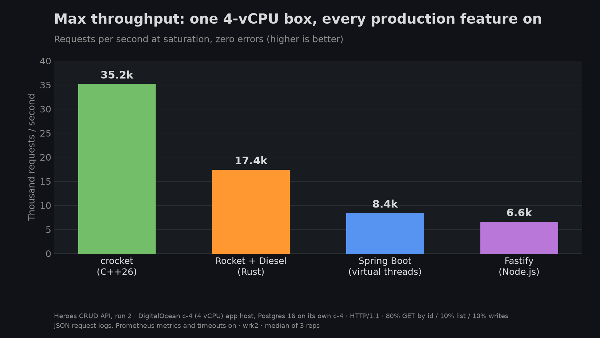
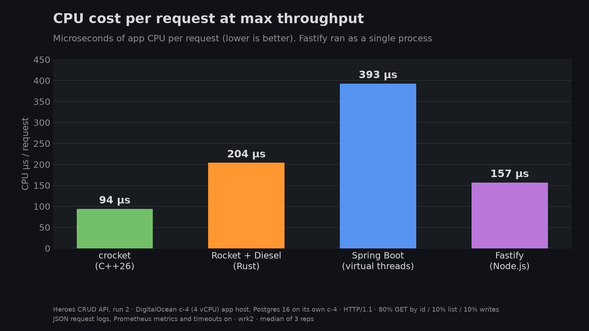
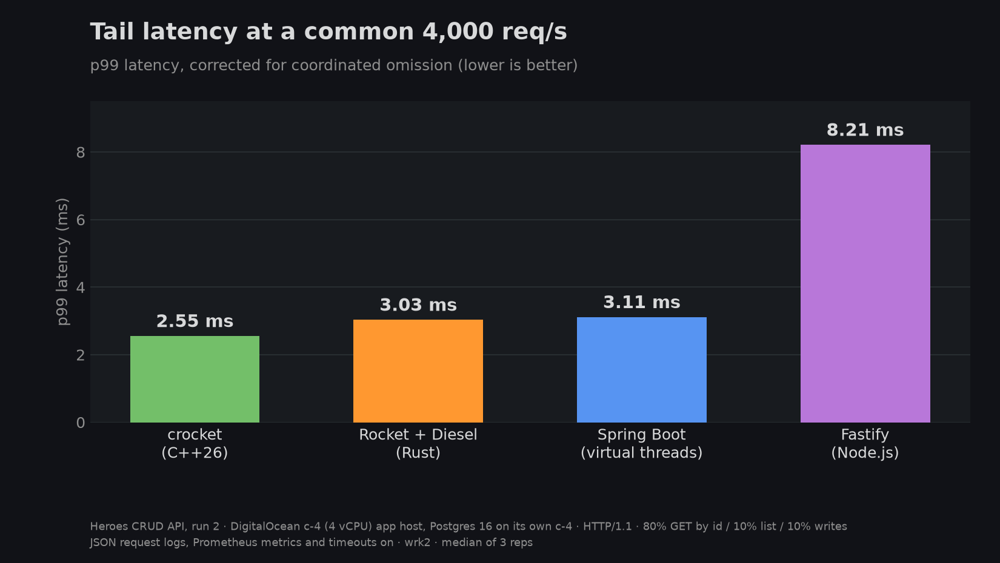
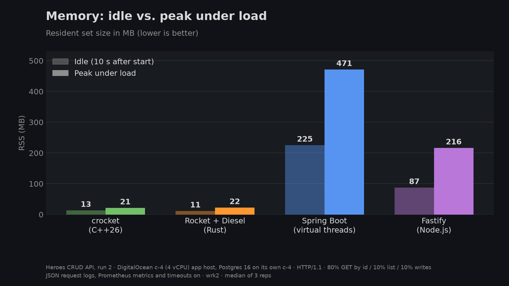

# heroes-shootout

One Heroes CRUD API, four stacks, the same Postgres, the same load. This repo holds the methodology, results, charts and flamegraphs behind the post **Where the cycles go: C++26, Rust, Java and Node on one CRUD API**.

| Contestant | Stack | Repo |
|---|---|---|
| crocket | C++26 reflection, GCC 16.2, libpqxx | [sean3z/heroes-crocket](https://github.com/sean3z/heroes-crocket) |
| Rocket | Rust, Rocket 0.5 + Diesel (diesel-async) | [sean3z/heroes-rocket](https://github.com/sean3z/heroes-rocket) |
| Spring Boot | Java 25, Spring Boot 3.5.16, virtual threads | [sean3z/heroes-spring](https://github.com/sean3z/heroes-spring) |
| Fastify | Node.js 24, Fastify 5.12.7, node-postgres | [sean3z/heroes-fastify](https://github.com/sean3z/heroes-fastify) |

Every app implements the same API contract and passes the same 15-check [`load/conformance.sh`](load/conformance.sh) against the same seed data ([`init.sql`](init.sql)).

## Methodology (Oct 15, 2026)

- **Rig:** 3 × DigitalOcean `c-4` droplets (4 dedicated vCPUs each) in nyc1 on a private VPC: one for the app, one for PostgreSQL 16, one for the wrk2 load generator.
- **Production features on for everyone:** a structured JSON log line per request, Prometheus metrics, 10 s request/query timeouts, a 16-connection Postgres pool. Each framework on its defaults otherwise (crocket: workers follow the pool → 16).
- **Load mix** ([`load/mix.lua`](load/mix.lua)): 80% `GET /heroes/{id}`, 10% `GET /heroes`, 5% `POST`, 5% `PUT`.
- **Max throughput:** 3 × 30 s at an unreachable rate. **Load ramp:** wrk2 constant rate at 0.25×–1.15× of each app's own max, plus a common 4,000 req/s level, 3 × 30 s per level (latencies corrected for coordinated omission). Tables show median (min–max).
- **Flamegraphs:** `perf` (async-profiler for the JVM) at 4,000 req/s and at saturation. crocket charts use a later FP-clean rebuild (static libstdc++, ubuntu:24.04 glibc with frame pointers); residual unresolvable frames folded for readability.
- **Cold start:** container start to first `200` on `GET /heroes/1`, n=3. Memory is RSS at startup, idle and peak under load.

## Headline results

| App | Max req/s (median) | CPU µs/req | p99 at 4k req/s | Idle / peak MB | Cold start |
|---|---|---|---|---|---|
| crocket | **35.2k** | **94** | **2.55 ms** | 13 / 21 | 324 ms |
| Rocket | 17.4k | 204 | 3.03 ms | 11 / 22 | **154 ms** |
| Spring Boot | 8.4k | 393 | 3.11 ms | 225 / 471 | 4.8 s |
| Fastify | 6.6k | 157 | 8.21 ms | 87 / 216 | 560 ms |

Full tables, flamegraph CPU buckets and caveats (including where crocket loses) are in [RESULTS.md](RESULTS.md).

## Flamegraphs

Interactive SVGs (open in a browser to zoom and search):

| App | 4,000 req/s | Saturation |
|---|---|---|
| crocket | [svg](flamegraphs/crocket_common.svg) | [svg](flamegraphs/crocket_saturation.svg) |
| Rocket | [svg](flamegraphs/rocket_common.svg) | [svg](flamegraphs/rocket_saturation.svg) |
| Spring Boot | [svg](flamegraphs/spring_common.svg) | [svg](flamegraphs/spring_saturation.svg) |
| Fastify | [svg](flamegraphs/fastify_common.svg) | [svg](flamegraphs/fastify_saturation.svg) |

## Caveats

Single cloud region and machine size; Postgres sits near its ceiling for crocket at max, so crocket's gap is if anything understated. crocket flamegraphs were re-captured with frame pointers (static libstdc++, ubuntu:24.04 glibc); Rocket/Spring/Fastify charts are from the earlier pass. See RESULTS.md for the rest.

## License

MIT. See [LICENSE](LICENSE).
